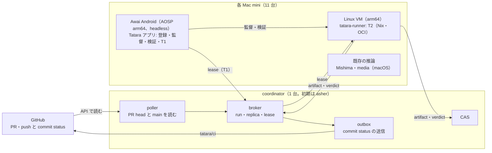

# Tatara で GitHub Actions を置き換える — Mac mini fleet の構成

- 状態: **設計**（2026-11-18）。owner の決定は下の §1 にあり、設計の残りはこの文書の提案。実装・実機の確認はまだない。
- Tracking: [AWAI-3404](https://linear.app/kotobalabs/issue/AWAI-3404)（親）、この文書は [AWAI-3405](https://linear.app/kotobalabs/issue/AWAI-3405)。
- 前提: 正本の設計書は awai-os の `docs/otehon/ci-app-20261117.md`（以下「設計書」）。この文書はその上に、fleet での実行・GitHub 連携・段階を足す。設計書の決定は変えない。

## 1. owner の決定（2026-11-18、チャットで回答）

| # | 決定 | 設計書との関係 |
|---|---|---|
| 1 | 各 mini で **Awai Android と Linux VM を併用する**。Android は Tatara の端末アプリとして、登録・監督・検証・決定的な Wasm（T1）を担う。Nix・OCI などの重いジョブ（T2）は同じ mini の Linux VM が実行する | 設計書 §5.3 の T1 / T2 を、1 台の mini の中で分担する |
| 2 | **canary 3 台から始める**（asher と他 2 台）。推論への影響を測ってから残り 8 台に広げる。資源の上限を固定する | 新規 |
| 3 | mini 上の Android は **fleet の機器**として扱い、**無人の runner を許す** | 設計書 §6.3 の案 C。利用者の電話の runner は有人（案 A）のまま。共有契約は変えない |
| 4 | fleet への経路は調べて直す。設定の変更は事前に確認する | AWAI-3406 |
| 5 | Mishima と media の推論なども、Android 上の Murakumo で行う | §8 の測定 gate を通す |

## 2. 全体の構成



- **coordinator** は fleet の制御面であり、end-user アプリではない（設計書 Q1 の整理に従う）。初期は 1 台で動かす。冗長化は後の段階にする。
- **runner** はどれも fleet 機器の DID を持つ。1 つの run の replica は、別々の DID の runner が実行する。quorum の既定は 2。
- **GitHub** は、イベントの取り込み元と結果の表示先としてだけ使う。実行・判定・artifact の保管は Tatara が持つ。GitHub Actions は実行経路に入らない。

## 3. 各 mini の中身

### 3.0 fleet の実態（2026-11-18 観測、読み取りのみ）

設計の前提を、実機の観測で確かめた。この節が下の表より新しい。詳細は [AWAI-3406](https://linear.app/kotobalabs/issue/AWAI-3406) と [AWAI-3411](https://linear.app/kotobalabs/issue/AWAI-3411)。

**入り方**: 11 台とも macOS のユーザー名は `node`（owner の情報）。tailnet 経由の 22 番は mini の Tailscale SSH が受け取る。この Mac（21mbp）の OS は MagicDNS を使っていないので、IP を直接指定する。

```bash
ssh -o ProxyCommand="tailscale nc <tailnet-ip> 22" -o HostKeyAlias=ts-<host> node@<tailnet-ip>
```

- 旧来の `~/.ssh/config` のユーザー名（asher、levi など）と、murakumo の `fleet.edn` の `:host`（`levi@levi` など）では入れない（`failed to look up local user`）。
- mini は 192.168.1.7 の NAT ルーターの向こうの有線 LAN にあり、この Mac の Wi‑Fi（192.168.1.1 側）とは別のネットワーク。fleet.edn の LAN IP（192.168.1.x）にはこの Mac から届かない。tailnet の経路は、levi・jacob が直接、他は DERP（tok）中継が多い。
- パスワードなしの sudo は全台で不可。root が要る操作（LaunchDaemon、`/etc/hosts`）は SSH だけでは進められない。

**11 台の状態**

| 項目 | 観測 |
|---|---|
| 機種・メモリ | 全台 Apple M4、16 GB |
| macOS | 26.3.1（jacob）〜 26.7.2 |
| 空き容量 | 76 GB（jacob）〜 164 GB |
| 負荷（1 分平均） | 1.1〜2.0 |
| 動いている VM | 10 台で「Awai OS」の qemu VM（約 4 GB）。levi と benjamin は「Awai Meiji Bot VM」（1 GB）も。issachar は「Lane test」も動き、VM 計 12 GB |
| Android エミュレータ | jacob で `awai-emu`（headless、`-memory 4096`、SDK は `/Users/node/Android/sdk`）が既に動いている |
| 推論プロセス | 全台で 0（mlx、ollama、llama-server、comfyui、mishima などが見当たらない） |
| ツール | Homebrew、Lima、bb は canary 3 台（asher、levi、naphtali）にある。Java と Android SDK は jacob 以外に未確認 |
| Node | simeon 以外の 10 台にある（`/opt/homebrew/bin/node`） |
| loopback の sshd | 全台で有効 |
| `21mbp.tail110d8b.ts.net` の解決 | jacob だけ 100.108.223.94。他の 10 台は LAN の DNS（192.168.1.1 / .9）が `10.10.10.1` を返す |

**設計への影響**

- メモリの予算は「推論と競合」ではなく、「既存の Awai OS VM（約 4 GB）と競合」として見る。runner VM と Android を足すと 16 GB のうち 10 GB を超えるので、canary では runner VM を 2 vCPU・4 GiB から始める。issachar（VM 計 12 GB）と jacob（空き 76 GB、エミュレータ稼働中）は canary から外す。
- 推論は今どの mini でも動いていないので、§8 の「macOS の推論を止めずに比べる」という前提は今は成り立たない。§8 は、新しく Android 上で推論を動かすときの測定 gate として読む。
- murakumo の `fleet.edn`（推論の役割、`:host`、LAN IP）は実態と合わない。食い違いとして報告し、murakumo 側の判断を待つ（この repo では書き換えない）。

| 構成要素 | 中身 | 上限（初期値。測定で見直す） |
|---|---|---|
| Awai Android | Android Emulator（Hypervisor.framework）で AOSP API35 arm64 を headless で起動する。launchd で常駐し、Tatara アプリを入れる。Awai 独自の ROM ができたら差し替える（AWAI-3061） | 2 vCPU、3 GiB |
| Linux VM | Lima（vz）の arm64 Linux。Nix と tatara-runner を入れる。launchd で常駐する | 4 vCPU、6 GiB、ディスク 80 GiB |
| 既存の推論 | 変更しない。§8 の gate を通るまで macOS のまま | — |

16 GiB の mini では、Android と VM で 9 GiB を使う。推論のモデルと競合するので、canary で実測してから上限を決め直す（§7）。

Android と VM の役割分担:

- Android の Tatara アプリは、その mini の runner DID を登録し、VM の runner が生きているか、何を実行しているかを表示する。VM が提出した verdict を、端末内で tatara-core の `verify` で検証する。決定的な Wasm ジョブ（T1）は Android 自身が実行する。
- 秘密（デプロイ資格、GitHub の token）は Android にも VM にも置かない。GitHub の token は coordinator だけが持つ。

## 4. GitHub 連携

### 4.1 取り込み

初期は **poller** にする。受信用の公開口（webhook）を作らずに済み、秘密も coordinator の外に出ないため。

1. 設定した repo ごとに、開いている PR の head と main の最新 commit を API で読む（既定 60 秒ごと）。
2. その commit に `.tatara/pipeline.edn` があれば、内容を読んで pipeline CID を計算し、イベント `{:forge "github" :repo :ref :sha :pipeline-cid}` を作る。
3. `tatara.core.run/normalize` と `admit` で RunRequest にする。同じ commit と pipeline のイベントは同じ run になる（重複の取り込みはまとめられる）。
4. 新しい run には commit status `tatara/ci` を pending で書く。

webhook は、poller の遅延が問題になってから検討する（Tailscale Funnel などの公開口と、署名の検証が必要になる）。

### 4.2 結果の返却

quorum が確定したら、outbox に commit status の送信を積む。

| quorum の結果 | commit status |
|---|---|
| 一致した verdict が passed | `success` |
| 一致した verdict が failed | `failure` |
| hard error（割れた verdict、同じ DID の二重提出） | `error`（説明に理由を書く） |

送信に失敗したら outbox から再送する。同じ送信は一度だけ届けば十分なので、内容のハッシュで重複を除く（`tatara.core.outbox`）。

## 5. pipeline の定義

repo に `.tatara/pipeline.edn` を置く。

```clojure
{:tier :t2                     ; :t1 は Android の Wasm、:t2 は Linux VM
 :network :fetch               ; :none か :fetch（§6）
 :timeout-seconds 3600
 :steps [["nix-build" "ci/otehon-car-check.nix" "--no-out-link"]
         ["nix-build" "ci/otehon-fs-check.nix" "--no-out-link"]]
 :artifacts []}                ; ホストが読んで CID を取るファイル
```

- step は argv の文字列ベクタだけにする。shell の文字列は受けない（tatara-core の規則）。
- pipeline の内容のハッシュが pipeline CID になる。runner は、checkout した commit の pipeline が coordinator の示した CID と一致するかを確かめてから実行する。
- GitHub Actions の workflow からの自動変換はしない。repo ごとに、同じ検査を pipeline に書き直す（T8）。

## 6. ネットワーク

tatara-core の T1 の規則（ネットワーク無し）は変えない。T2 には次の 2 つを用意する。

| 値 | 意味 |
|---|---|
| `:none` | VM の中で step を実行するとき、外へ出られない（既定） |
| `:fetch` | Nix の substituter と、pipeline が宣言した取得先だけに出られる。verdict にこの値が入るので、quorum する runner はみな同じ条件で実行したことになる |

`:fetch` の実現方法（VM の firewall か、Nix の sandbox と substituter の設定か）は T5 で決める。取得したものは digest で検証する（Nix の固定出力など）。

## 7. 段階

| 段階 | 内容 | 完了の証拠 | issue |
|---|---|---|---|
| S0 | この文書 | merge | AWAI-3405 |
| S1 | fleet への経路 | canary 3 台に非対話で入れる | AWAI-3406 |
| S2 | coordinator（永続 broker、HTTP API、CAS、quorum） | 2 runner の e2e、再起動、古い lease、水増し、割れた verdict の試験 | AWAI-3407 |
| S3 | GitHub 連携（poller と commit status） | network-awai-apex の PR に `tatara/ci` が出る | AWAI-3408 |
| S4 | Linux VM runner（T2） | 2 台で network-awai-apex の otehon check の verdict が一致する | AWAI-3409 |
| S5 | Android アプリ（fleet 機器モード） | AOSP エミュレータで起動し、run を検証できる | AWAI-3410 |
| S6 | canary 3 台に常駐 | 3 台が quorum に参加し、推論への影響を測って記録する | AWAI-3411 |
| S7 | 残り 8 台と repo の移行 | 11 台と主要 repo | AWAI-3412 |
| S8 | 推論を Android に移す | §8 | AWAI-3413 |

S6 と S7 の境目、S8 の切り替えは、測定値を見て owner が承認する。

## 8. 推論を Android に移すときの gate

owner の指示（§1 の 5）は、Mishima と media の推論を Android 上の Murakumo で動かすことである。次の制約があるので、測定してから切り替える。

- 2026-11-18 の観測では、どの mini でも推論プロセスは動いていない（§3.0）。fleet.edn は MLX / MPS での推論を前提にしているが、今は稼働していない。比べる相手は、同じモデルを macOS ネイティブで動かした測定値になる。
- Mac 上の Android エミュレータからは、Metal / MLX の GPU を計算に使えない。Android の中で使えるのは CPU（NEON）と、gfxstream 経由の Vulkan（計算に使えるかは未検証）である。
- そのため、とくに画像・動画（SDXL、LTX）は大幅に遅くなる見込みである（未測定）。

手順:

1. Android で動く推論 runtime を選び（llama.cpp の CPU / Vulkan など）、Murakumo の推論 API と同じ形で載せる。
2. canary 1 台で、同じモデル・同じ入力について、遅延・throughput・出力を macOS ネイティブと比べる。
3. 結果を owner に示す。足りない場合の代案は、推論は macOS に残し、Android の Murakumo からは呼び出すだけにする形である。

今の推論サービスは、測定と owner の承認の前に止めない。

## 9. 未決定事項

- coordinator を置く mini（初期は asher を候補）と、その冗長化。
- quorum の数（既定 2）と、repo ごとの上書き。
- `:fetch` の実現方法（§6）。
- Android エミュレータの system image（Google の AOSP image を使うか、Awai の build を待つか）と、その digest の固定。
- runner DID の鍵の置き場所（VM の中か、Android の Keystore か）。初期は VM の中のファイルにし、権限を 600 にする。
